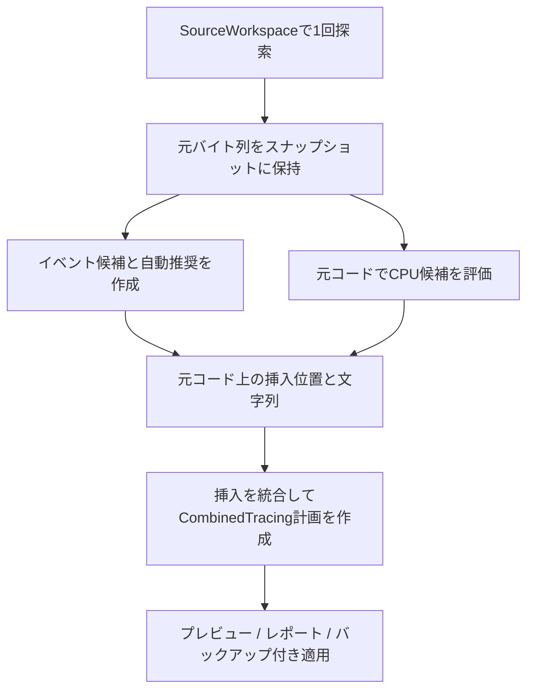

# CPU・イベント統合付与（Issue #45）

[目次](../README.md) / [各機能の付与ロジックとEngine参照](current-feature-logic.md) / [イベントの自動推奨](automatic-counter-preview.md)

## 操作

メイン画面の「CPU・イベント統合付与」から新しいウィンドウを開く。
従来のCPU・イベントの個別画面も利用できる。

1. Sourceフォルダーのフルパスを指定する。フォルダードロップにも対応する。
2. 「解析・プレビュー」を1回押す。CPUスコープとイベントカウンターの変更案を同時に作る。
3. ファイル一覧のCPU・イベント・DECREMENT・ADDの件数、付与前後のコード、付与内容・判定理由を確認する。
4. 変更候補のあるファイルは選択済み。不要なファイルを外し、「元ファイルへ適用」でまとめて適用する。

解析・プレビュー・レポート保存では元ソースを書き換えない。
適用では対象ファイルを確認し、両方の付与前の元ファイルを`.ueetc-backups`へ保存してから書き込む。
2つの画面を順に適用する操作や、中間状態の元ファイルへの保存は必要ない。
全解除した場合は適用できず、自動で全件適用に戻すこともない。
検索で隠れたファイルの選択は保持する。全体・表示中・強調行の選択/解除、Ctrl/Shift・Spaceにも対応する。

CPUは従来どおり対象の絞り込みを標準にする。「全関数（互換）」と自動/通常形/固定STRの選択も利用できる。
設定を変更した場合は変更案を無効にし、再解析する。
ソースパス・検索条件は統合画面専用のキーで保存し、個別画面の入力とは分ける。計画や適用選択は保存しない。

統合画面ではイベントの自動推奨を採用し、適用対象はファイル単位で選ぶ。
カウンター名・数量・分岐候補を個別に編集したい場合は、従来のイベント画面を使う。
個別画面の手編集を、統合画面の解析へ自動的に持ち込む機能ではない。

## 付与条件

個別機能と同じルールを共通Coreから利用する。

| 対象 | 統合画面の既定 |
| --- | --- |
| CPU | ループ・対象API・4箇所以上の処理呼び出し等を根拠に絞る。安全な同名Super呼び出しがあればその後へ置く |
| イベント | 対応する非空のif/else分岐入口へ累積INCREMENT |
| ADD | 型・数量名・直接バッチ等から安全に1つ推奨できる入力数量を別カウンターへ加算 |
| DECREMENT | 対応する入力配列の直接バッチに、累積回数を保持する別ActiveScopesを追加し、退出ガードで減算 |

同じ関数や同じファイルに必ず両方を付けるのではなく、条件に合う種類だけを追加する。
CPUのみ、イベントのみ、両方、どちらも追加しないファイルが混在してよい。
既存のCPU計測やカウンター操作は個別機能と同様に維持し、再解析で重複しないようにする。
旧Consoleの`--both`はCPUと関数進入回数の互換モードで、この統合機能とは異なる。

## 共通Coreの構成

- [CombinedTracingService](../../src/UEEtc.Core/Features/CombinedTracing/CombinedTracingService.cs)を`UEEtc.Core.Features.CombinedTracing`に追加した。
- WPFは`UEEtc.Wpf.Features.CombinedTracing.CombinedTracingWindow`から呼び出す。
- Consoleの`combined`コマンドも同じサービスを呼び出す。



`EventCounterService.Analyze`の探索結果にある元バイト列を両機能で共有する。
ファイル探索とスナップショット取得は1回だが、それぞれの既存パーサーによる判定処理は行う。
「C++を1つのパーサーで一度だけ解析する」という実装ではない。

CPUをイベント付与後のコードへかけ直さない。生成したINCREMENT/ADD/ON_SCOPE_EXIT等が、CPUの負荷候補判定や元行番号に影響するのを避ける。
[SourceInsertion](../../src/UEEtc.Core/Source/SourceInsertion.cs)に元ソース上の位置と挿入文字列を持ち、両機能の挿入を後ろから適用する。
同じinclude挿入位置では決めた順番で連結し、既存の先頭includeを維持する。
CPU側は旧関数進入カウンターを生成せず、イベント側の識別子割り当てと混在させない。

`AnalysisPlan.Feature`は`CombinedTracing`。元バイト列、文字コード、BOM、改行を保持する。
FunctionsにはCPU判定とイベント判定を別行で記録するため、「付与箇所」はユニークな関数数とは限らない。
診断は両方を統合する。診断がある場合は適用を許可しない。
挿入位置の内部データはJSONへ出力せず、レポートには従来の判定・件数、差分と加工済みコピーを出す。

適用は既存の`SourceWorkspace.Apply`へまとめた計画を渡すだけで、1ファイルを2回書き込まない。
解析後の編集検出、全件バックアップ、途中失敗時の復元は既存の仕組みを共用する。

## Console

元ソースは`--apply`を指定するまで変更しない。次の例は差分とコピーの出力のみ。

```powershell
dotnet run --project src/UEEtc.Console -- combined "D:/Game/Source" --report "D:/TraceReports/combined"
```

CPUの設定例:

```powershell
dotnet run --project src/UEEtc.Console -- combined "D:/Game/Source" --all-functions --cpu-macro str --report "D:/TraceReports/combined-str"
```

統合コマンドでは、対象となるイベント候補と自動推奨を一括生成する。
既存`counters`コマンドの空の選択ファイルや`--selection`の運用は変更しない。

## 検証

- Releaseビルド: 警告0・エラー0。
- Core 123/123。両種の挿入、固定STR、Super後の配置、生成カウンターがCPU絞り込みに影響しないこと、既存計測の維持、名前衝突、BOM/CRLF、1回探索、再解析、部分適用とバックアップ、元ソース変更検出、診断・取消を確認。
- WPF 137項目。メイン画面から個別ウィンドウとして開き、1回の解析で両種のコード・件数を表示。初期選択・全解除・検索・STR再解析・一部ファイルへの適用を確認。スクリーンショットも目視確認。
- `Test-CombinedTracing.ps1`: MSVC C++20 `/W4 /WX`、auto/STR × CPU有効/無効 × Counters有効/無効の8構成でコンパイル・実行。
  実UEの`ScopeExit.h`と計測スタブを使い、Super後のCPU開始、早期return・例外、累積3、入力数量9、現在数の退出後0、CPU開始/終了4回を検証。
- `Invoke-CombinedTraceExperiments.ps1`: ゲームは読み取り、加工済みコピーと差分で確認。結果は下表。

| コピー実験 | cpp解析 | 変更ファイル | CPU | イベント | ADD | DECREMENT | 診断 | 2度目の変更 |
| --- | ---: | ---: | ---: | ---: | ---: | ---: | ---: | ---: |
| Lyra | 233 | 188 | 451 | 1525 | 4 | 4 | 0 | 0 |
| BlockBreaker | 47 | 38 | 93 | 423 | 0 | 0 | 0 | 0 |

差分の`git apply --check`が通り、元ソース599ファイルのSHA256は実験前後で一致した。
これは対応構文のコピー生成検証で、UEゲーム全体のビルド・実際のInsightsでの測定は行っていない。
