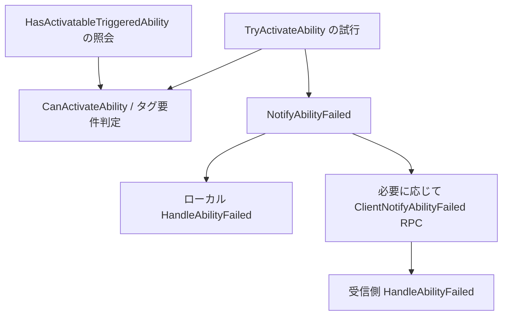

# イベントカウンターを効果的な位置へ絞る再調査

[目次](../README.md) / [再オープンした Issue #10](https://github.com/posita33/UEEtc/issues/10) / [前回の実装](event-counters.md)

## 結論

前回の「波括弧付き if / else を広く列挙する」方法は、数える位置を作ることはできても、診断に有効な位置を選べていません。1,948 件は認識できた構文の数であり、有用な計測箇所の数ではありません。条件式に Cache / Hit / Success / Valid が含まれることも、採用の十分条件ではありません。

今回は性能原因と不具合の診断を主目的に、**測定する事象・母数・単位・実行主体・重複のない記録位置が説明できるものだけを優先する**方針へ見直します。対象コードを読んだ推奨候補を先に少数作り、一般の分岐は補助探索とするのが適切です。

これは再調査と次の実装条件の提案です。この変更では候補抽出・挿入処理を変更せず、ゲームのソースにも付与していません。今の画面が新しい条件で自動的に絞り込むわけではありません。

## Engine を増分の前後まで調べた結果

対象は `C:/Program Files/Epic Games/UE_5.8/Engine/Source` と `Engine/Plugins`。`.cpp` / `.h` の INCREMENT と、同名に対する DECREMENT / SUBTRACT / SET / ADD 等を再集計しました。

| 観察した項目 | 件数 |
| --- | ---: |
| INCREMENT の記述箇所 | 76 |
| INCREMENT に渡す識別子 | 51 |
| そのうち減算も記述される識別子 | 15 |
| そのうち SET も記述される識別子 | 4（上記 15 に含まれる） |
| 減算または SET がある識別子への INCREMENT 記述箇所 | 19 |

全 51 名を対応する操作の一覧へ照合しました。コメントだけの行と define 行は除外しますが、名前空間、リンク、条件コンパイル、マクロの展開、実行頻度を解決しないテキスト集計です。15 名すべてを機械的に「ゲージ」と確定するものではなく、ライフサイクルの確認が必要な対象です。残る 36 名も、未発見のラッパー等を含めて累積専用であると証明したわけではありません。

`scripts/Measure-EngineCounterLifecycles.ps1` で再現できます。今回の CSV・集計は `artifacts/counter-lifecycles/20261016-120315/` に保存し、識別子数と増分箇所数が CSV の合計と一致することも確認しました。Engine のコード本文は Git に転載しません。

### 名前より、操作とライフサイクルを優先する

| 実例（Engine 相対パス、2026-10-16 時点） | 見直した判断 |
| --- | --- |
| `Source/Runtime/CoreUObject/Private/Serialization/BulkDataStreaming.cpp:623,631` の `BulkDataBatchRequest_Count` | コンストラクターで増え、デストラクターで減る。名前に Count があっても、生存中の要求を数える形 |
| `Source/Runtime/AudioMixer/Private/AudioMixerSourceManager.cpp:1036,4220,4343` の `AudioMixerSourceManager_TotalQdCmds` | Total を含む名前でも減算がある。名前だけでは累積と判定できない |
| `Source/Runtime/StorageServerClient/Private/Cache/CacheJournalSimple.cpp:37,75-76,84,89-90` | 起動時の復元、無効化時の SET、削除時の減算がある。一方 Invalidated は無効化要求の回数で、実際に見つかって削除できた数とは異なる |
| `Source/Runtime/Engine/Private/ShaderCompiler/ShaderCompilerJobCache.cpp:1759,1771,1793` | 検索試行、メモリヒット、DDC 要求は別の段階・母数。GetHit だけを増やしても原因やヒット率を判断できない |
| `Source/Runtime/Experimental/IoStore/OnDemand/Private/OnDemandContentInstaller.cpp:1309,1313,1328` | 取消・HTTP エラー・検証成功を分け、成功は内容のハッシュ検証後。呼び出し開始や HTTP 2xx だけを成功にしない |
| `Source/Runtime/Engine/Private/Streaming/SimpleStreamableAssetManager.cpp:564` | 二重登録の自己修復経路。正常時と異なる処理に進んだ回数を数え、異常頻度の観察に結び付く |
| `Plugins/Mutable/Source/MutableRuntime/Private/MuR/System.cpp:205` | 特定の更新処理の入口で増やしている。以後の検証で失敗し得るため、意味は更新の試行であり完了ではない。分岐内だけが有効な配置ではない |

カウンターを置く位置は「分岐の先頭」ではなく、その数が意味する事象が確定する地点で決めるべきです。試行なら呼び出す直前、結果なら戻り値・検証を確認した直後、復旧なら復旧経路を選んだ地点になります。操作を二度評価したり、通知と配送先の両方へ同じ意味の増分を入れたりしてはいけません。

## 前回の Lyra 候補を再評価

前回選んだ `DoesAbilitySatisfyTagRequirements` の `bBlocked` / `bMissing` は、**条件チェックで拒否した回数**としては読めますが、**実際に発動を試みて失敗した回数**ではありません。失敗イベントを調べる標準候補からは外すべきです。

Engine の `Plugins/Runtime/GameplayAbilities/Source/GameplayAbilities/Private/AbilitySystemComponent_Abilities.cpp:2472-2489` の `HasActivatableTriggeredAbility` は、実際の発動処理を行わず `CanActivateAbility` で可否を照会します。同プラグインの `Private/Abilities/GameplayAbility.cpp:457,528` では CanActivate からタグ要件を調べます。Lyra の `CanActivateAbility` も `Super::CanActivateAbility` を呼びます。このため同じタグ判定は照会でも通る構造です。

より適切な候補は `LyraGame/AbilitySystem/LyraAbilitySystemComponent.cpp:320,330` の `NotifyAbilityActivated` / `NotifyAbilityFailed` です。ただし、単純に名前が Notify だから採用するのではなく、Engine の `InternalTryActivateAbility` などから呼ばれる経路と、Lyra の RPC 配送を確認する必要があります。



上図は主要な呼び出し関係です。TryActivate の失敗すべてが Notify へ進むことや、一つの通知と一つのユーザー入力が一対一であることを保証する図ではありません。

### 数える際の条件

- `NotifyAbilityFailed:330` と `ClientNotifyAbilityFailed_Implementation:392` / `HandleAbilityFailed:397` を同じ失敗カウンターとして全て数えると、通知と配送を重ねる可能性がある。観測主体を一つ選ぶ。
- 匿名名前空間のカウンターはファイル内の全インスタンスで共有される。PIE の複数ワールドやクライアント／サーバーを同じプロセスで動かす場合、プロセス内合計と権威側だけの件数を区別する。
- `TryActivateAbility` が true を返しても、Engine `AbilitySystemComponent_Abilities.cpp:1647-1671` にはリモート要求を送って true を返す経路がある。戻り値を「サーバーで発動完了」とは呼べない。
- Lyra の `ProcessAbilityInput:216,283` は入力処理から試行を呼ぶ。`LyraPlayerController.cpp:375-380` の入力処理経路もあり、保持入力では繰り返し試行する。入力した回数と試行回数は別の単位。
- 理由別の件数を追加するときは FailureReason の複数タグによる二重計上を設計する。有限の分類を決め、総失敗数を一度だけ数える。各理由の合計が総数に一致するとは自動的に仮定しない。

当面の名前案は `AbilityActivationNotifications` / `AbilityFailureNotifications` です。「その観測プロセスに届いた通知回数」として、実行主体を明記します。成功率として割り算するには、予測・権威・RPC・再試行を含めた同じ母集団の定義が別途必要です。名前や数式だけで一意な試行 ID を作ったことにはなりません。

## 前回の BlockBreaker 候補を再評価

対象は `BlockBreaker/Private/Framework/GameModes/BlockBreakerGameMode.cpp`。性能・異常原因を調べるときの優先度を整理しました。実行頻度や実際の異常発生を測った順位ではなく、読み取れる測定目的に基づく順位です。

| 前回の候補 | 再評価 | 理由 |
| --- | --- | --- |
| `OnBrickDestroyedEx:96` の除去フォールバック | 優先 | 登録集合から除去できなかった通知を切り分ける。ただし未登録・重複・null をまとめた経路であり、「二重通知」と断定しない |
| `SpawnNewBall:60` の不正引数 | 診断目的で優先 | 処理を進められない理由が明確。一般的な `if (Actor)` 全てを数えるのとは異なる、用途を読んで選ぶガード |
| `SpawnNewBall:76` の SpawnActor 成功 | 単独では不足、試行・失敗と組にする | 作成を試した回数と失敗経路がなければ成功の多寡を説明しづらい。Catch 成功ではない |
| `CheckClearCondition:416` のクリア判定 | 標準のカウンター候補から下げる | まれな状態遷移。時刻・前後関係が知りたい場合は Bookmark の方が目的に合う |
| `PlayerDied:308` のゲームオーバー判定 | 標準のカウンター候補から下げる | セッション統計という目的なら有用だが、一般の性能診断のための累積増分には優先しない |

スポーンについて先に定義すべきものは、例えば `BallSpawnAttempts`（SpawnActor を実際に呼ぶ直前）、`BallSpawnSuccesses`（非 null 確認後）、`BallSpawnFailures`（null 確認後）です。不正引数の早期 return は SpawnAttempts の母数へ含めず別件にします。現在の式を二度実行して成否を調べてはいけません。現在ない else を生成する必要がある場合も、制御フローが変わらない設計・検証が必要です。

ブリックについては `Gameplay/Actors/Bricks/Brick.cpp:360-365,436-439,506-513` を追いました。HP <= 0 は破壊処理を呼び出す条件ですが、HandleDestruction はデータ不在で戻ることがあり、最後の Destroy 呼び出しも実際の成功確認とは異なります。「HP 条件を通った回数」をそのまま「ユニークに破壊したブリック数」にしないでください。Destroy の戻り値や、二重処理を防ぐ状態の設計まで確認する必要があります。

[Epic の Trace Developer Guide](https://dev.epicgames.com/documentation/en-us/unreal-engine/developer-guide-to-tracing-in-unreal-engine) は、低頻度のゲーム状態の変化には Bookmark、頻度の高い観測にはタイマーやカウンターという用途を示しています。Counter へ全て寄せるのでなく、求める答えが時刻なのか累積数なのかで使い分けます。

## 次の実装での候補採用条件

先に扱う候補は、次の 3 系統に絞る提案です。

| 測定系統 | 採用に必要な根拠 | 自動採用しないもの |
| --- | --- | --- |
| 操作の試行と確定結果 | 同じ操作の呼び出し位置と結果の確認位置が対応し、試行・成功・失敗の単位が明確 | 関数名や変数名が Success / Hit なだけの分岐 |
| 想定外経路・復旧・再試行 | 回避／復旧の処理や失敗を打ち切る処理まで読み、通常経路と区別できる | 通常のポインター確認、設定フラグ、単なる return・getter |
| 検証済みの操作イベント通知 | 呼び出し元が確認でき、配送・予測・重複と、実行主体を決められる | On / Notify / Failed という名前だけの関数入口 |

「ループ内だから一律に外す」だけでも不十分です。処理する要素ごとの試行・結果がループ内にあることは普通で、Engine の要求処理にも例があります。逆に Tick の普通の分岐を全て採用するとノイズになります。ループは「一要素につき一回」の単位と負荷を確認できたものだけを個別に扱います。

表示候補は少なくとも「測定目的／数える単位／実行主体／同じ測定の他の位置／根拠となる前後処理／推奨 Counter 名／現在の実装で付与可能か」を持つ必要があります。固定の認識済みパターンか、利用者が登録した計測仕様を使い、単語スコアだけを採用根拠にしません。

現行の分岐入口モデルでは、操作直前・戻り値確認後・通知関数の適切な地点へ付与できない場合があります。これらは次の実装で挿入位置の種類を増やす必要があるため、今回の研究結果を既存の Add 処理へ無理に当てはめていません。

## 検証・残る作業

今回実施したのは、新しい Engine 操作一覧の採取、数の整合性確認、上記の定義・呼び出し経路と前後処理の読み取りです。以前の 7 箇所の選択例は構文確認用の履歴として残し、新しい既定の推奨箇所とは扱いません。

今後は少数の測定系統を対象に、候補抽出と位置生成を実装し、合成 fixture で分岐・戻り値・副作用回数が変わらないこと、同じ実イベントを重複計上しないことを確認する必要があります。さらに UE 上で通常系・失敗系・リトライ・PIE 複数ワールドを実行し、計測コストと実際のカウントを確認します。

ゲーム／Engine の元ソース、候補抽出ロジックは今回変更していません。UE のビルド・実行、Insights の取得、異常頻度・負荷の比較は未実施です。新しい条件の実装が残るため、Issue #10 はオープンのまま継続します。

再現コマンド（リポジトリルート）:

```powershell
./scripts/Measure-EngineCounterLifecycles.ps1
```
