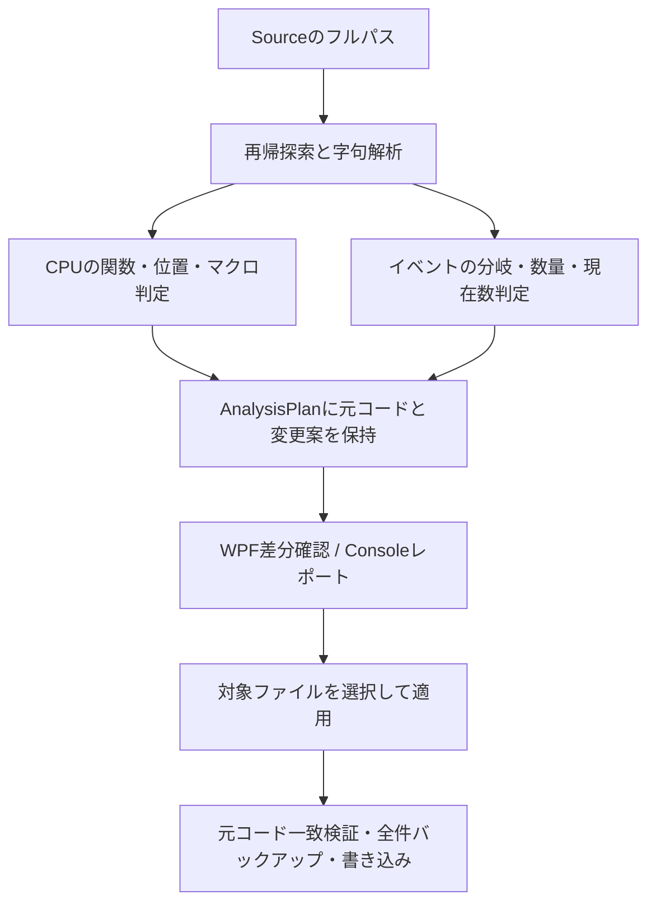

# 現行2機能の付与ロジックとEngineの参照箇所

[目次](../README.md) / [操作説明](automatic-counter-preview.md) / [新機能の候補](trace-feature-candidates.md)

2026-10-16時点の実装を、CPUスコープ付与とイベントカウンター付与の2機能に分けて整理する。
両機能を1回の操作で実行する[統合画面（Issue #45）](combined-tracing.md)も利用できる。各機能の条件は以下と共通である。
[Engine監査と責務分離（Issue #47）](engine-audit-and-refactoring.md)に、最新の構成とgotoの安全対策を記録している。
Engineの調査対象は `C:/Program Files/Epic Games/UE_5.8/Engine`。以下のEngine参照パスはこのフォルダーからの相対パスで、行番号もこのインストールに対応する。
他のUEバージョンではマクロ定義と利用例を確認し直す。

## まず何を測るか

| 機能・指標 | 測るもの | 測らないもの |
| --- | --- | --- |
| CPUスコープ | 挿入位置からC++スコープを抜けるまでの経過時間 | GPU時間、起動した非同期処理の完了までの時間 |
| イベントのCount | 選んだif/else分岐への累積進入回数 | 条件の意味から推定した成功件数 |
| イベントのInputBytes / InputItems | 分岐入口で受け取った入力数量の累積 | 実際に成功・送信・処理完了した数量 |
| イベントのActiveScopes | 選んだ分岐のスコープ内にいる現在数 | 要求やActorの生存数、非同期処理の完了待ち数 |

CPUとイベントを必ずセットでは追加しない。CPU画面は時間、イベント画面は分岐・数量を独立して扱う。
旧Consoleの `--both` / `--counter-only` は互換用の関数進入回数で、現行イベント画面のCountとは対象が違う。

## 共通の処理経路



- [SourceWorkspace](../../src/UEEtc.Core/Source/SourceWorkspace.cs)が通常の`.cpp`を探索する。`.gen.cpp` / `.generated.cpp`、ThirdParty、Intermediate、Binaries、Saved、bin、obj等を除外する。リンク・ジャンクションも除外し診断する。
- ヘッダーは書き換えない。カウンター名の予約のため、対象配下の`.h` / `.hpp` / `.inl` / `.cc` / `.cxx`を読む場合がある。
- [CppLexer](../../src/UEEtc.Core/Source/CppLexer.cs)でコメント、通常文字列、raw文字列、プリプロセッサー行を区別する。C++コンパイラーのASTや型解決は利用しない。
- エンコーディング・BOM・改行を維持し、必要なincludeは既存の先頭include群の後に置く。ソース固有の最初のincludeを維持する。
- 解析・レポート保存は元ソースを書き換えない。WPFでは解析時に変更候補のあるファイルを選択するが、書き込みは「元ファイルへ適用」の確認後に行う。
- 適用時は診断・数量未確認を検査し、解析時の元バイトと現在のファイルを比較する。全変更ファイルを[設定したソース外のバックアップ先](backup-location.md)へ保存してから書き込み、途中失敗時は書き込み済みの変更を復元する。

## 1. CPUスコープ付与

### 関数の選定

[CppInstrumenter](../../src/UEEtc.Core/Features/FunctionTracing/CppInstrumenter.cs)が、namespace内を含む通常のクラス外関数定義を調べる。
空の関数、コンストラクター・デストラクター、constexpr / consteval、テンプレート、operator、requires、function-try-block、コルーチン、特殊な宣言は除外または手動確認にする。
安全な無条件includeの挿入位置がない場合も追加しない。

既存の`TRACE_CPUPROFILER*`、`SCOPE_CYCLE_COUNTER`系、`SCOPED_NAMED_EVENT*`が関数内にあればCPU計測を維持する。
コメント・文字列内のマクロ名は既存計測と数えない。既存のSTRやTEXTを通常形へ置換する機能ではない。

WPFと現行Consoleの`cpu`コマンドは、さらに[CpuScopeFocus](../../src/UEEtc.Core/Features/FunctionTracing/CpuScopeFocus.cs)で以下のいずれかを確認する。

| 採用根拠 | 現在の条件 |
| --- | --- |
| 繰り返し | `for` / `while` / `do`がある |
| 対象API | `Serialize`、`Deserialize`、`Compress`、`Decompress`、`Uncompress`、`Flush`、`Wait`、`WaitForCompletion`、`ParallelFor`、`LoadFileToArray`、`SaveArrayToFile`、`Sort`、`StableSort`の呼び出し |
| 複数の処理 | 処理呼び出し箇所が4以上ある |

呼び出し箇所の数から`Get*` / `Is*` / `Has*` / `Can*`、`UE_*` / `TRACE_*`、check / ensure系や制御構文を外す。ラムダ内だけにある仕事も根拠にしない。
Super後に挿入する場合は、その後の領域に対して判定する。
これは**実行コストを測定した判定ではなく、ツール独自の静的な絞り込み**。Engineに「4呼び出しで付ける」という規約があるわけではない。
「全関数（互換）」または`--all-functions`で絞り込みを外せる。Core APIと旧Consoleの既定値まで変更したものではない。

### 挿入する位置と名前

[CpuScopePlacement](../../src/UEEtc.Core/Features/FunctionTracing/CpuScopePlacement.cs)が挿入位置を決める。

1. `Super::同じ関数名(...)`がなければ、本体の入口に置く。
2. 関数直下の独立した無条件文として同名Superを1回だけ呼ぶ場合は、その直後に置く。Superより前の処理も計測から外れる。
3. 同名Superが条件内・代入・return式・ラムダ内にある、複数回ある、関連する条件コンパイルがある場合は自動配置しない。gotoで初期化を飛び越す可能性がある関数も、Super後への自動配置を行わない。
4. Super後に処理が残っていなければ追加しない。

[CpuScopeMacro](../../src/UEEtc.Core/Features/FunctionTracing/CpuScopeMacro.cs)は、通常「クラス名 関数名」の固定ラベルを作る。
自動モードではASCII識別子を空白で区切った名前なら通常形、それ以外は固定文字列のSTRを選ぶ。設定で通常形・STRも指定できる。

生成イメージ（`AAnalyzer.cpp`の本体内、Super直後）:

```cpp
TRACE_CPUPROFILER_EVENT_SCOPE(AAnalyzer Process);
```

通常形の引数はマクロ内で文字列化されるため、この空白区切りの書き方でも固定名になる。
STRを選ぶ場合は`TRACE_CPUPROFILER_EVENT_SCOPE_STR("AAnalyzer Process");`となる。
UE 5.8では通常形とSTRは同じ静的IDの経路を通る。**STRは動的文字列専用ではない**。
毎回変わる名前には別のTEXT系があるが、現行ツールは生成しない。

### CPUで参考にしたEngine箇所

| Engine内のパス・行 | 確認した内容 | ツールへの反映 |
| --- | --- | --- |
| `Source/Runtime/Core/Public/ProfilingDebugging/CpuProfilerTrace.h:19–25, 399–409, 445–454` | 有効条件、STRの固定名・静的ID、通常形からSTRへの展開 | 正しいヘッダーと固定ラベル、通常形/STR選択 |
| 同上 `:253–277, 283–342, 473–490` | 静的IDと動的名は経路が異なる | 固定名を標準とし、動的名は別候補にする |
| `Source/Runtime/Engine/Private/AssetCompilingManager.cpp:674–680` | 完了待ちと管理対象のループにCPUスコープ | 待機・一括処理を観測対象とする判断材料 |
| `Source/Runtime/Engine/Private/InstancedStaticMesh.cpp:433, 778, 1023, 4472` | RHI初期化、バインド、インスタンス一括更新 | 処理単位の時間を観測する判断材料 |
| `Plugins/Runtime/InstancedActors/Source/InstancedActors/Private/InstancedActorsModifierVolumeComponent.cpp:57–59, 100–102, 154` | 同名Super後のBeginPlay/EndPlayと独自の一括更新 | Super後から独自処理を測る配置 |

## 2. イベントカウンター付与

### 候補の検出

[EventCounterService](../../src/UEEtc.Core/Features/EventCounters/EventCounterService.cs)から呼ぶ[EventCandidateDiscovery](../../src/UEEtc.Core/Features/EventCounters/EventCandidateDiscovery.cs)が、[CppStructure](../../src/UEEtc.Core/Source/CppStructure.cs)で識別できる通常の関数を調べ、非空の`if (...) { ... }` / `else { ... }`を候補にする。
ネストした通常分岐も調べる。ループ・switch・catch・ラムダ・ローカルクラス内は探索せず、波括弧なしの分岐は書き換えない。
特殊な宣言、コルーチン、関数内のプリプロセッサー、条件コンパイル下の関数、constexpr分岐等は保守的に外す。
分岐直下に既存の`TRACE_COUNTER_*`操作があれば、その分岐は候補から外す。既存CPUスコープだけでは除外しない。

`cache` / `hit` / `fail`等の条件名は「キャッシュ候補」「結果・ガード候補」等の**表示ヒントと並べ替え**に使う。
これらの単語だけで採否・成功・失敗の意味は決めない。現在のCount候補は一般の条件分岐も含むため、不要なものは一覧で外す。
たとえば`if (Result)`に入った回数を、処理完了や命中と断定しない。

### 生成する指標

| 指標 | 追加条件・動作 |
| --- | --- |
| 累積Count | 選ばれた分岐入口に`TRACE_COUNTER_INCREMENT`。標準では減算しない |
| 入力数量ADD | 安全な数量をちょうど1つ推奨できれば、別カウンターに`TRACE_COUNTER_ADD` |
| 別のActiveScopes | ADDの根拠が入力配列の直接ループである場合だけ、別カウンターの入口INCREMENTと退出DECREMENTを自動追加 |
| 手動のActiveScopeモード | 詳細設定でCount自体を現在数へ変更する互換モード。別ActiveScopesとの二重指定は禁止 |

[QuantityCounterValues](../../src/UEEtc.Core/Features/EventCounters/QuantityCounterSelection.cs)で数量式を制限する。

- スカラーは既知の符号なし32bit以下の値引数のみ。uint8/16/32、uint8_t/16_t/32_t、unsigned int/short/char等。signed、uint64、参照、ポインター、既定引数、任意の型別名は推奨しない。
- そのスカラー名を挿入位置より前で使っていたら、シャドーイングや変更を解決せず候補から外す。
- 配列は対応する単純な要素型の`const TArray<T>&`、`TConstArrayView<T>`系引数の`.Num()`。その前の利用は`Num()` / `IsEmpty()`だけを許す。任意のコンテナー、入れ子テンプレート、独自allocator等は扱わない。
- 任意の関数呼び出しや副作用のある式は受け付けない。手入力では一覧の式、またはuint32範囲の十進整数を許す。

[QuantityRecommendation](../../src/UEEtc.Core/Features/EventCounters/QuantityRecommendation.cs)で意味を絞る。
スカラーではNumBytes / ByteCount / BytesWritten等をbytes、NumItems / ItemCount / NumElements等をitemsにする。
Sizeのような単位不明の名前や、数量候補が複数ある場合は自動設定しない。
配列は分岐の直接のforヘッダーで、その配列をrange-forまたは`.Num()`付きで使用していることを条件にする。
ループが内側の別分岐やラムダにしかない場合、外側にその数量を推奨しない。

[EventCounterDefaults](../../src/UEEtc.Core/Features/EventCounters/EventCounterDefaults.cs)で、この判定をWPF/Console共通の初期案に変換する。
自動の数量名はInputBytes / InputItemsとし、入力数量という意味を固定する。値・単位を手編集した場合は確認状態を解除する。

### DECREMENTと名前の扱い

ActiveScopesには`ON_SCOPE_EXIT`を使い、通常退出・return・例外で減算する。
Countを減らさず、独立した現在数を追加するため、累積回数を失わない。
**直接バッチに別の現在数を付けるのはツールの独自方針**。Engineの非同期Inflightを字句解析だけで再現しているわけではない。
バッチ内で非同期処理を開始しても、現在数が表すのは呼び出し側分岐のスコープだけである。
gotoを含む関数では、初期化を飛び越す可能性があるため退出ガードを自動挿入せず、手動の現在数指定も拒否する。

生成イメージ（`BatchProcessor.cpp`の分岐内）:

```cpp
TRACE_COUNTER_INCREMENT(BatchProcessor_Process_If1_Count);
TRACE_COUNTER_INCREMENT(BatchProcessor_Process_If1_ActiveScopes);
ON_SCOPE_EXIT
{
    TRACE_COUNTER_DECREMENT(BatchProcessor_Process_If1_ActiveScopes);
};
TRACE_COUNTER_ADD(BatchProcessor_Process_If1_InputItems, Items.Num());
```

別途、必要な`CountersTrace.h` / `ScopeExit.h`とatomic整数カウンター宣言を生成する。
宣言はファイル内の無名namespaceへ置いて内部リンケージにする。ただしUnityビルドや既存宣言との衝突までnamespaceだけで解決できるわけではない。
識別子はクラス・関数・分岐番号の読める名前を基本とし、候補全体・既存ヘッダー・マクロ展開名`__GTraceCounter...`との衝突時だけ接尾辞を付ける。
`UEEtcCalls_`は付けない。Insights表示名は短いクラス・関数・分岐を先頭とし、数量に単位を付ける。
atomic更新はデータ競合を避けるためで、複数スレッドのトレース出力順序や業務データの読み取り安全性まで保証しない。

### イベントで参考にしたEngine箇所

| Engine内のパス・行 | 確認した内容 | ツールへの反映 |
| --- | --- | --- |
| `Source/Runtime/Core/Public/ProfilingDebugging/CountersTrace.h:16–24, 310–317, 387–402, 473–478` | 有効条件、atomic宣言、SET/ADD/INC/DEC、無効時の展開 | 宣言と操作のセット生成、式の副作用を避ける |
| `Source/Developer/IoStoreUtilities/Private/IoStoreWriter.cpp:3946, 3953` | DDC Hit/Missは別々の累積回数 | 累積Countへ無条件のDECREMENTを付けない |
| 同上 `:3364, 3412–3413, 3474, 3493` | 投入時にInflight増加、対応する非同期完了時に減少。Doneは別に加算 | 累積と現在数を分離。非同期完了を自動推定しない |
| 同上 `:374, 394, 427, 441` | バッチのInflightへ要求数を加算し、各完了で減算 | 入力数量と生存中数量を区別する判断材料 |
| `Source/Developer/DerivedDataCache/Private/HttpCacheStore.cpp:3156, 3179, 3166, 3201` | 入力バッチのRequests.Num()と、完了後のHitを別計測 | InputItemsと成功件数を分離 |
| 同上 `:2771–2772, 2870–2871` | 完了後の物理Read/Writeバイト数をADD | 入力バイト数を実転送量と呼ばない |
| `Source/Runtime/Core/Public/Containers/Array.h:1388–1391`、`Containers/ArrayView.h:441–444` | Num()が保持する要素数を返す | 対応するconst入力配列の数量式 |
| `Source/Runtime/Core/Public/Misc/ScopeExit.h:28–31, 59–73` | 退出時に実行するガード | 分岐の現在数をreturn・例外でも戻す |

## 有効条件・結果の確認

CPUとCountersのヘッダー既定値は`UE_TRACE_ENABLED && !UE_BUILD_SHIPPING`に従うが、ビルド側の明示指定もある。
コンパイル時に有効でも、取得時に対象の`cpu` / `counters`チャンネルが有効でなければ欲しい記録は得られない。
[公式のチャンネル一覧](https://dev.epicgames.com/documentation/en-us/unreal-engine/trace-in-unreal-engine-5)と[Trace Developer Guide](https://dev.epicgames.com/documentation/en-us/unreal-engine/developer-guide-to-tracing-in-unreal-engine)も参照。

現行のコピー実験ではLyraの直接バッチ4箇所にADDとDECREMENTを追加でき、BlockBreakerは両方0だった。
対象はSpawnEquipmentActors、UpdateInteractions、GetFirstRandomUnoccupiedPlayerStart、AddUnconfirmedServerSideHitMarkers。
これは対応構文の検出結果であり、性能上の問題箇所を実測で発見した件数ではない。
[実験・検証記録](automatic-counter-preview.md#検証)には、元ソース不変、再解析、C++ガード動作の検証をまとめている。
UEプロジェクト全体のビルド、実際の`.utrace`、Insightsでの効果確認は別途必要。

## 変更する場合の入口

| 変更したいこと | 共通Coreの入口 |
| --- | --- |
| CPUの候補・配置・マクロ | `Features/FunctionTracing/CppInstrumenter.cs`、`CpuScopeFocus.cs`、`CpuScopePlacement.cs`、`CpuScopeMacro.cs` |
| イベントの候補・検証・生成 | `Features/EventCounters/EventCandidateDiscovery.cs`、`EventSelectionValidator.cs`、`EventCounterPlanBuilder.cs`。`EventCounterService.cs`は組み立てと公開API |
| 数量・直接バッチの推奨 | `Features/EventCounters/QuantityCounterSelection.cs`、`QuantityRecommendation.cs`、`EventCounterDefaults.cs` |
| ファイル探索・適用 | `Source/SourceWorkspace.cs` |
| 変更案・レポート・差分 | `Plans/AnalysisPlan.cs`、`Reporting/ReportExporter.cs`、`Reporting/ChangedLineMap.cs` |

上のCoreパスは`src/UEEtc.Core/`からの相対パス。
WPFは`Features/CpuTracing` / `Features/EventCounters`の別画面を使い、共通Coreにルールを置く。
Coreの名前空間は`UEEtc.Core.Features.FunctionTracing`と`UEEtc.Core.Features.EventCounters`。
今後の候補も機能ごとに名前空間と画面を分け、探索・変更案・適用の共通部分を再利用する。
